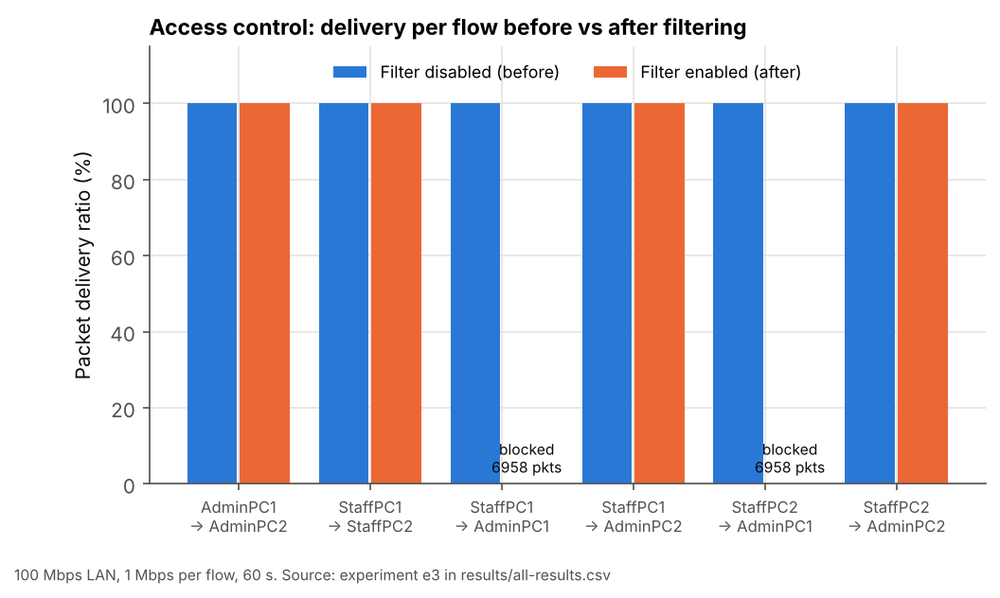
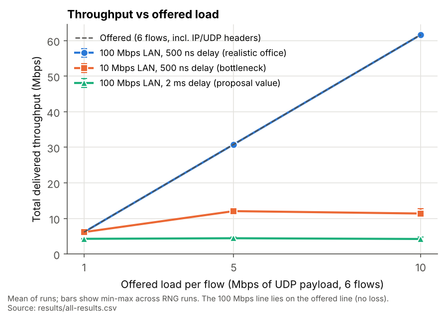

# Design and Testing of a Small Office Network Using ns-3

**COMP 3343 — Data Communications and Computer Networks, Acadia University**
Group: Jay Patel, Emith Weligamage, Jenish Prajapati, Muntha Rahman

A simulated two-department office network built in **ns-3.49** (C++), with:
IPv4 subnetting, routing between departments, a router access-control filter
that blocks Staff from reaching Admin PC1, UDP traffic generation, and
measured throughput, delivery ratio, loss and delay. All results are produced
by the scripts in this repository. No numbers were typed in by hand.

| Stage | Content | Git tag |
|---|---|---|
| 1 | Research, environment, version selection, risks | `stage-1-research` |
| 2 | Minimal simulation, office topology, addressing, routing | `stage-2-topology` |
| 3 | Access-control packet filter | `stage-3-access-control` |
| 4 | Experiments, CSV export, graphs, automated tests | `stage-4-experiments` |
| 5 | Documentation and final validation (this version) | `stage-5-complete` |

---

## 1. Overview and motivation

The original proposal used Cisco Packet Tracer. We moved to **ns-3**, a
*discrete-event network simulator*: it models packets, protocols and links as
events on a simulated clock, instead of emulating Cisco IOS commands. So the
proposal's objectives were adapted to ns-3's own building blocks. Some
examples: a Cisco ACL became a filter inside the router's IP forwarding path,
and "VLANs" became two separate CSMA (shared-Ethernet) segments. See
`docs/project-background.md`.

**Question investigated:** how can a small office network provide reliable
communication between departments while restricting access to selected
devices, and how does it perform under different traffic loads?

## 2. Network topology and addressing

```
                     [ Router ]
          192.168.10.1 |      | 192.168.20.1
        ---------------+      +---------------
        Admin LAN (CSMA)        Staff LAN (CSMA)
         /          \             /          \
    Admin PC1    Admin PC2    Staff PC1    Staff PC2
  192.168.10.10 192.168.10.11 192.168.20.10 192.168.20.11
```

| Device | Department | Subnet | IPv4 address | Gateway |
|---|---|---|---|---|
| Router (Admin interface) | — | 192.168.10.0/24 | 192.168.10.1 | — |
| Router (Staff interface) | — | 192.168.20.0/24 | 192.168.20.1 | — |
| Admin PC1 (protected) | Admin | 192.168.10.0/24 | 192.168.10.10 | 192.168.10.1 |
| Admin PC2 | Admin | 192.168.10.0/24 | 192.168.10.11 | 192.168.10.1 |
| Staff PC1 | Staff | 192.168.20.0/24 | 192.168.20.10 | 192.168.20.1 |
| Staff PC2 | Staff | 192.168.20.0/24 | 192.168.20.11 | 192.168.20.1 |

More detail is in `docs/addressing-plan.md`.

## 3. Software requirements

| Software | Version used | Notes |
|---|---|---|
| Linux (Ubuntu 24.04 tested) | — | macOS and WSL2 should also work with ns-3 |
| g++ (or clang++) | 13.3 | C++20 is required by ns-3.49 |
| CMake | 3.28 | ≥ 3.13 |
| Ninja or Make | — | used by `./ns3` |
| Python 3 | 3.13 | with `pandas` and `matplotlib` |
| Git | — | |
| **ns-3** | **3.49** | the newest release when the project was built |
| Wireshark | optional | to open `.pcap` files if you enable pcap yourself |

## 4. Installation

```bash
# 1. Get ns-3.49 (official GitHub mirror; nsnam.org has the same release)
git clone --depth 1 --branch ns-3.49 https://github.com/nsnam/ns-3-dev-git.git ns-3.49
cd ns-3.49
./ns3 configure --enable-modules="core;network;internet;csma;applications;flow-monitor" \
                --disable-examples --disable-tests --disable-python
./ns3 build            # first build takes a few minutes
cd ..

# 2. Get this project and link it into ns-3's scratch/ folder
git clone https://github.com/ponzi-scheme/Data_Comm_Project.git small-office-ns3
cd small-office-ns3
scripts/link-into-ns3.sh ../ns-3.49

# 3. Python packages for the analysis
pip install pandas matplotlib
```

`link-into-ns3.sh` makes two symbolic links:
`ns-3.49/scratch/minimal-two-node.cc` and `ns-3.49/scratch/small-office/`.
It also saves ns-3's location in `.ns3-path` so the Python scripts can find it.

## 5. Project structure

```
small-office-ns3/
├── README.md
├── simulation/
│   ├── minimal-two-node.cc          # Stage 2 sanity check (2 nodes, 1 flow)
│   └── office-network/              # the main program (one ns-3 scratch program)
│       ├── office-network.cc        # topology, routing, traffic, measurement, checks
│       ├── network-config.h         # parameters, addressing plan, flow table
│       └── access-control.h         # ACL-style router packet filter
├── scripts/
│   ├── link-into-ns3.sh             # links the sources into an ns-3 tree
│   ├── run-experiments.py           # runs all 31 experiment runs -> results/
│   └── analyze-results.py           # validates results, draws figures, writes summary
├── tests/
│   ├── test_project.py              # 15 automated tests (unittest)
│   └── test-plan.md                 # what is tested and the recorded outcomes
├── results/                         # real simulation output (see results/README.md)
├── figures/                         # graphs made from results/all-results.csv
├── docs/                            # background, architecture, design, limitations, log
└── report/report-outline.md         # outline for the 8+ page report
```

## 6. How to compile

```bash
cd ns-3.49
./ns3 build minimal-two-node office-network
```

## 7. How to run the simulation

Run from inside the `ns-3.49` folder. The whole program and its options go in **one quoted string**:

```bash
./ns3 run minimal-two-node                         # prints sent=10 received=10
./ns3 run office-network                           # baseline: 6 flows, 1 Mbps each, 60 s
./ns3 run "office-network --PrintHelp"             # list every option
./ns3 run "office-network --flows=inter --loadMbps=5 --outDir=/tmp/out"
```

| Option | Default | Meaning |
|---|---|---|
| `--flows` | `all` | `all`, `intra`, `inter`, or flow ids such as `1,3,5` (table below) |
| `--loadMbps` | `1` | offered load **per flow**, in Mbps of UDP payload |
| `--packetSize` | `1024` | UDP payload bytes |
| `--csmaRate` | `100Mbps` | data rate of both LANs |
| `--csmaDelay` | `500ns` | LAN propagation delay (`2ms` = the proposal's value, see §12) |
| `--simTime` | `60` | simulated seconds; traffic runs from 1 s to `simTime − drainTime` |
| `--drainTime` | `2` | quiet time at the end so queued packets can arrive |
| `--enableFilter` | `false` | turn the access-control filter on |
| `--filterSendIcmp` | `false` | denied packets also fire the router's Drop trace and an ICMP reply |
| `--seed`, `--run` | `1`, `1` | random-number seed and run number |
| `--outDir` | (none) | write `flows.csv`, `metadata.txt`, `validation.txt`, `routing-tables.txt`, `flowmon.xml` |
| `--experiment` | `adhoc` | label written into the output files |

| Flow id | Source → Destination | UDP port |
|---|---|---|
| 1 | Admin PC1 → Admin PC2 | 5001 |
| 2 | Staff PC1 → Staff PC2 | 5002 |
| 3 | Staff PC1 → Admin PC1 | 5003 |
| 4 | Staff PC1 → Admin PC2 | 5004 |
| 5 | Staff PC2 → Admin PC1 | 5005 |
| 6 | Staff PC2 → Admin PC2 | 5006 |

Every run prints `CHECK PASS/FAIL` lines covering node count, addresses,
routes, IP forwarding, the filter policy, counter consistency and loss
accounting. It exits with code **1 if any check fails**, so a broken network
can't pass silently.

## 8. How to enable filtering

```bash
./ns3 run "office-network --enableFilter=true"                        # silent drop
./ns3 run "office-network --enableFilter=true --filterSendIcmp=true"   # + Drop trace + ICMP
```

Expected: flows 3 and 5 (Staff → Admin PC1) receive **0** packets and show
`blocked_packets` = packets that reached the router. All other flows are
unaffected. How the filter works is explained in `docs/access-control.md`.

## 9. How to run all experiments

```bash
python3 scripts/run-experiments.py          # ~35 s; 31 runs, 3 RNG runs per load point
python3 scripts/run-experiments.py --runs 5 --sim-time 120   # more runs / longer
```

This writes `results/runs/<run_id>/`, `results/all-results.csv` and
`results/run-manifest.json` (ns-3 version, git commit, exact commands, exit
codes). Failed runs are listed at the end, and the script exits non-zero.
Experiment design: `docs/experiment-design.md`.

## 10. How to analyze results

```bash
python3 scripts/analyze-results.py
```

This checks the CSV (12 checks), draws `figures/fig1`–`fig6` and writes
`results/summary.md`. If an experiment's data is missing, its figure is skipped and the gap is reported.

## 11. How to run the tests

```bash
python3 -m unittest discover -s tests -v    # 15 tests, ~5 s
```

Test plan and recorded outcomes: `tests/test-plan.md`.

## 12. Expected functionality and key results

All values come from `results/summary.md` (60 s runs):

* **Same department (Exp. 1)** and **across departments (Exp. 2):** 100% delivery,
  ~0.09 ms (same LAN) and ~0.17 ms (through the router) average delay.
* **Access control (Exp. 3):** with the filter on, Staff → Admin PC1 delivers 0 of
  6958 packets (all 6958 blocked at the router, 0 forwarded). Staff → Admin PC2
  and same-department flows stay at 100%.
* **Load (Exp. 4):** on the realistic 100 Mbps LAN, 1, 5 and 10 Mbps per flow are
  all delivered (≥ 99.99%). On the 10 Mbps bottleneck LAN, delivery falls to about
  39% at 5 Mbps and about 18% at 10 Mbps per flow, with average delay rising from
  ~2 ms to ~200+ ms. Practically all loss is caused by full transmit queues.
* **Proposal's 2 ms delay:** ns-3's CSMA channel stays busy for the whole
  propagation delay, so each frame takes ~2.1 ms of channel time. A "100 Mbps" LAN
  then behaves like a ~4 Mbps one, and even 1 Mbps per flow loses ~31%.




## 13. Known limitations

The short version (full list in `docs/limitations.md`):

* These are simulation results; they don't predict a real office's performance.
* The two departments are separate CSMA segments, **not** IEEE 802.1Q VLANs.
* ns-3's CSMA model is a shared, half-duplex bus, not a modern switched full-duplex LAN.
* The filter matches IPv4 source/destination only, and it is not Cisco IOS.
* Traffic is constant-bit-rate UDP only; TCP was not evaluated.

## 14. Troubleshooting

| Problem | Fix |
|---|---|
| `ns-3 location unknown` | Run `scripts/link-into-ns3.sh /path/to/ns-3.49` |
| `./ns3 run office-network` says the program isn't found | Re-run the link script, then `./ns3 build`; check that `scratch/small-office` is a link to `simulation/office-network` |
| Options are ignored | Put program and options in one quoted string: `./ns3 run "office-network --enableFilter=true"` |
| A run exits with code 1 | Read the `CHECK FAIL:` lines in its output or `validation.txt` |
| Exit code 2 | Invalid option value (for example `--flows=9`) |
| `ModuleNotFoundError: pandas` | `pip install pandas matplotlib` |
| Build is slow | Configure only the modules listed in §4 |
| Very large losses at low load | Check `--csmaDelay`; `2ms` throttles the CSMA channel (see §12) |
